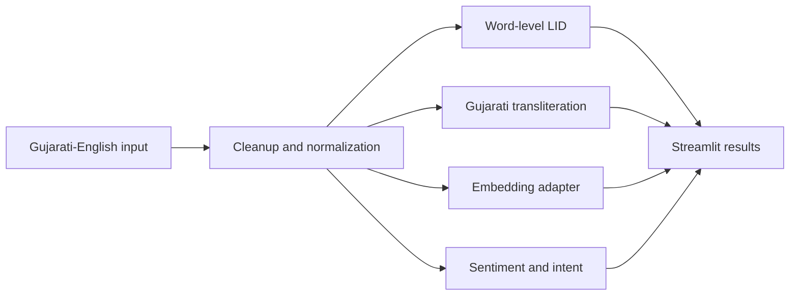

# Gujarati-English Code-Mixed NLP

  

A modular starting point for understanding Gujarati-English code-mixed messages. It includes text normalization, word-level language identification, dictionary-assisted transliteration, optional multilingual embeddings, and a sentiment/intent demo.

> **Data note:** The included 22 examples and bundled baselines are illustrative only. They are not statistically representative and should not be treated as production-quality predictions. Validate on a consented, representative dataset before using this for decisions.

## Features

- Unicode Gujarati script detection and word-level tags: `GUJ_SCRIPT`, `ENG`, `TRANSLITERATED_GUJ`, and `SYMBOL_NUMBER`.
- URL, HTML, and mention cleanup plus configurable informal spelling normalization.
- Exact and fuzzy dictionary lookup for common Romanized Gujarati words.
- Optional Sentence Transformers embeddings through LaBSE.
- Sentiment and intent prediction interface with confidence values.
- Streamlit interface for interactive exploration.

## Project layout

```text
data/       sample CSV, processed token example, transliteration dictionary
models/     normalization rules, LID estimator, mBERT config placeholder
notebooks/  preprocessing/LID, transliteration/embedding, model training demos
src/        reusable NLP modules
app.py      Streamlit application
```

## Setup

Use Python 3.10 or newer. From the project root:

```bash
python -m venv .venv
# Windows: .venv\Scripts\activate
# macOS/Linux: source .venv/bin/activate
pip install -r requirements.txt
```

Run the interface:

```bash
streamlit run app.py
```

The app's lexical classifier works without model downloads. Embeddings are loaded only when requested through `CodeMixedEmbedder`; the first call downloads its selected model. The mBERT configuration file is a placeholder, not a trained checkpoint.

## Python usage

```python
from src.preprocessing import preprocess_pipeline
from src.language_id import identify_languages
from src.transliteration import GujaratiTransliterator
from src.classification import MultiTaskClassifier

message = "Kem cho bhai? Website gr8 che!"
cleaned = preprocess_pipeline(message)
print(cleaned)
print(identify_languages(cleaned))
print(GujaratiTransliterator().transliterate(cleaned))
print(MultiTaskClassifier().predict(cleaned))
```

To generate embeddings after installing the optional dependencies:

```python
from src.embeddings import CodeMixedEmbedder
vectors = CodeMixedEmbedder().encode(["Kem cho?", "મજામાં છું"])
```

## Architecture



## Training and data

The CSV uses `id`, `text`, `sentiment`, and `intent`. Replace or extend it with examples representative of the audience, dialects, scripts, and platform conventions you need to support. Keep user data consented and remove personal information. The LID module exposes `train_lid_model(words, labels)` to create a TF-IDF/RandomForest word tagger. Notebook 03 outlines the multi-task fine-tuning workflow; a real mBERT checkpoint requires labeled data and compute.

## Limitations

- Gujarati transliteration has many valid spellings; dictionary and edit-distance matching are only a baseline.
- Unrecognized Romanized Gujarati words may be tagged as English.
- Confidence values from the bundled lexical classifier are heuristic scores, not calibrated probabilities.
- The sample corpus is intentionally small and is not suitable for model evaluation or deployment.

## Team

Project team: Gujarati-English Code-Mixed Text Understanding System. Add contributor names, affiliations, and contact details here.

## License

MIT. See [LICENSE](LICENSE).
